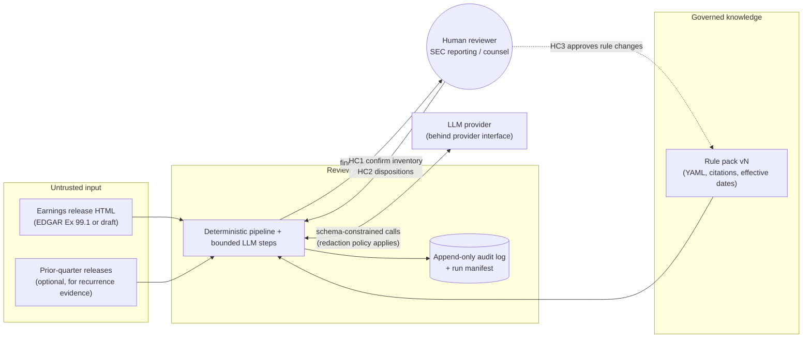
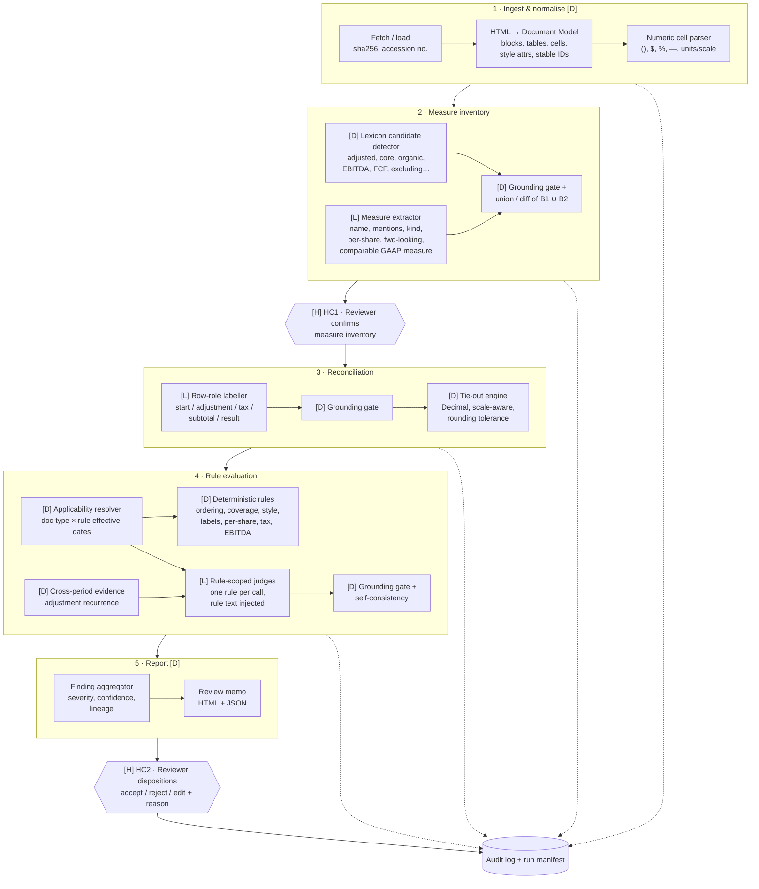

# Architecture — Non-GAAP Earnings-Release Review Assistant

**Status:** `APPROVED`. Human sign-off 2026-11-02, with amendments ADR-014…ADR-019 incorporated below.
**Version:** 1.0 · 2026-11-02 (v0.1 drafted 2026-11-01)
**Changes from v0.1:**
- §4.4: tie-out subtotals and polarity (ADR-014)
- §4.5 / §6.2: finding category `REQUIREMENT` vs `STAFF_COMMENT_RISK` (ADR-017)
- §4.7: recurrence diff becomes optional enrichment (ADR-016)
- §4.8 / §7.5: k=1 with escalation only (ADR-015)
- §12 / §15: static HTML UI (ADR-018)
- §11: env-based config (ADR-019)
- §16: build order
**Related:** [test_plan.md](test_plan.md) · [ADRs](../../tracking/decisions.md) · [Rejected alternatives](../../tracking/rejected-alternatives.md) · [Open questions](../../tracking/open-questions.md)

---

## 0. Problem statement

**Who.** The SEC reporting / disclosure team at a US-listed company (controller, SEC reporting manager, disclosure counsel) reviewing a draft quarterly **earnings release**: Form 8-K Item 2.02, usually Exhibit 99.1.

**Task.** Before the release goes out, someone checks every non-GAAP measure (Adjusted EBITDA, adjusted EPS, free cash flow, "core" or "organic" metrics) against:
- **Regulation G** (17 CFR 244.100);
- **Item 10(e) of Regulation S-K** (17 CFR 229.10(e)) [VERIFIED: Cornell LII];
- the **SEC staff's Non-GAAP C&DIs**, last updated 2022-12-13 [VERIFIED: sec.gov].

Today this means re-reading the release line by line, re-footing the reconciliation tables by hand, and comparing the wording against roughly 25 staff interpretations.

**How often.** Every quarter, for every non-GAAP measure, on a compressed timeline (hours to days before release). Repeated for 10-Q/10-K MD&A.

**What it costs today.** Senior reviewer time on a deadline. Non-GAAP is consistently among the **top SEC comment-letter topics** [SECONDARY: Deloitte Non-GAAP Roadmap, 12 months to 2025-07-31]. A comment letter means a public correspondence trail, possible restated presentation, and reputational cost. Hard numbers on the cost per comment are `[UNVERIFIED]` and will not be claimed in the brief without a source.

**Why now.**
1. The 2022-12-13 C&DI update tightened 100.01 (recurring now includes "occasionally, at irregular intervals"), 100.04, 100.05, 100.06 and 102.10. Firms' internal checklists that predate it are stale.
2. IFRS 18 (effective 2027-01-01) brings "management-defined performance measures" into audited IFRS statements. The same review problem is moving into the audit perimeter. This is an adaptability target, not in scope (§13).

**In scope (prototype).** US SEC registrants; English-language **HTML** earnings releases (8-K Ex 99.1) for historical periods, plus forward-looking guidance detection. Output is a **review memo of findings for a human**, not a pass/fail certification.

**Out of scope.**
- PDF/scanned/image tables (returned as `NOT_EVALUATED`).
- Charts and graphs (C&DI 102.10(a) bullet 6): flagged `NOT_EVALUATED` when detected.
- Foreign private issuers (C&DI 106.x).
- REIT FFO specifics (102.01/102.02).
- Business-combination forecasts (101.x).
- Segment measures under ASC 280, which are by definition *not* non-GAAP (104.01). We must not flag them; see test D10.
- Legal sign-off: the system never declares a release "compliant".
- 10-K/10-Q MD&A (same rules, longer documents; a natural extension).

---

## 1. Design principles (non-negotiables)

| # | Principle | How it shows up |
|---|---|---|
| P1 | **The LLM never decides a number.** | All arithmetic is `Decimal` in code. The LLM labels *which* cells play which role; code reads values from the parsed table, not from LLM output. |
| P2 | **No claim without a span.** | Every LLM output must quote verbatim text. A deterministic verifier checks that the quote exists in the source and maps it to a block or cell ID. If it fails, the output is rejected. |
| P3 | **Knowledge lives in a versioned rule pack, not in the model.** | Each rule is a YAML record with a citation, source URL, effective date, applicability and check type. Prompts are generated from the rule pack, so the model is told the rule rather than recalling it. |
| P4 | **Confirm probabilistic facts before deterministic rules consume them.** | The human confirms the measure inventory at checkpoint HC1. Downstream "deterministic" findings are only as trustworthy as their inputs, and lineage records which inputs were LLM-derived and whether a human confirmed them. |
| P5 | **Abstain over guess.** | Tri-state verdicts: `PASS` / `FLAG` / `NEEDS_REVIEW`, plus `NOT_EVALUATED` for unsupported input. Thresholds favour recall: a missed issue costs more than a reviewer dismissing a flag. |
| P6 | **Every run is replayable.** | A run manifest pins input hash, rule-pack version, model ID, prompt hashes and raw LLM responses. Replaying from cache gives a byte-identical report. |
| P7 | **Fixed workflow, not an autonomous agent.** | A DAG of typed steps. LLM calls are bounded functions with schemas, not free-roaming tool loops. See ADR-002. |

---

## 2. System context and trust boundaries



**Trust boundaries.**
1. **Document text is data, never instructions.** It could contain prompt injection; see §7.4.
2. **LLM output is untrusted until verified.** The schema validator and grounding gate (P2) sit between every LLM call and the rest of the system.
3. **Rule-pack changes are a privileged action** (HC3), versioned and reviewed like code.

---

## 3. Architecture overview

Three lanes. Each step is labelled **[D]** for deterministic, **[L]** for an LLM step (always followed by a [D] verifier) or **[H]** for a human checkpoint.



**Why this shape.** The problem breaks into three kinds of work, and each gets the tool that fits it:

| Kind of work | Example | Tool | Why |
|---|---|---|---|
| Structural fact | "Non-GAAP EPS appears in the headline; GAAP EPS doesn't" | Parser + rules [D] | Exact, cheap, reproducible. An LLM here only adds variance. |
| Semantic identification | "'Core earnings' is a non-GAAP measure; its comparable GAAP measure is net income" | LLM [L] + grounding + **human confirmation** | Labels vary unboundedly, so a lexicon alone misses novel names (see D5). |
| Normative judgment | "Is 'store pre-opening costs' a normal, recurring cash operating expense?" (100.01) | Rule-scoped LLM judge [L] + evidence + `NEEDS_REVIEW` routing | Facts-and-circumstances language; the SEC itself frames it that way. |

---

## 4. Component specifications

### 4.1 Ingest [D]
- **Input:** an EDGAR accession number (fetches the primary Ex 99.1) or a local HTML file (drafts).
- **Output:** raw bytes stored immutably, `sha256`, and metadata (CIK, form, filed date, period).
- **Failure modes:**
  - Non-HTML input → `NOT_EVALUATED`.
  - EDGAR rate limit (SEC fair-access policy: declared User-Agent, ≤10 requests/second) → backoff.

### 4.2 Document model [D]
The HTML is normalised into blocks and tables, each with stable IDs:
- `Block{id, kind: headline|heading|paragraph|bullet|caption|footnote, text, char_span, style{bold, italic, font_size_px, emphasis_rank}, order}`
- `Table{id, caption, header_rows, rows[Row{id, label, cells[Cell{id, raw, value: Decimal|None, scale, unit, col_header_path}]}]}`

**Why a custom model rather than plain text into the LLM.** Prominence is about position and style, which plain text throws away. Exact tie-out needs cell-level numbers.

**Hard parts:**
- Merged header cells (`colspan`) that build period paths such as "Three Months Ended › Sep 30, 2026".
- Scale declared once in a caption ("in thousands, except per share").
- Parentheses for negatives and em dashes for zero.
- Footnote markers glued to numbers (`1,234(a)`).
- Inline CSS vs class-based styles.

**Failure modes:**
- A mis-parsed header path picks the wrong period column. This is the most likely silent error; see FMEA §14.

### 4.3 Measure inventory [D + L + H]
- **[D] Lexicon detector.** High-recall regex and lexicon for non-GAAP signals, plus "non-GAAP" anchor phrases and reconciliation-table captions.
- **[L] Extractor.** Returns `Measure{name, aliases[], mentions[{block_id, quote}], kind: performance|liquidity|unknown, per_share: bool, forward_looking: bool, comparable_gaap: {name, quote}, confidence}`.
- **[D] Union/diff.** A lexicon hit the LLM did not explain is surfaced as an "unexplained candidate". An LLM measure with no lexicon support is surfaced as a "novel measure".
- **[H] HC1.** The reviewer confirms, edits or adds measures, and confirms `kind` and the comparable GAAP measure.

**Why the gate goes here.** Everything downstream keys off this inventory. A missed measure means *all* its checks silently don't run (the weakest point, §14). Confirming 3–8 measures takes a reviewer about two minutes and is the highest-leverage place to spend their attention.

**Prototype mode.** HC1 can be pre-filled from the gold label file to run the eval unattended. This is reported as a **separate metric**: "inventory recall without HC1".

### 4.4 Reconciliation [L + D]
- **[L] Row-role labeller.** For each reconciliation table it returns:
  - per row: `role ∈ {gaap_start, adjustment, tax_effect, subtotal, nongaap_result, memo, other}` and `sign_hint ∈ {as_printed, subtract}`;
  - the measure the table reconciles;
  - the period columns.

  Its output contains **row and column IDs only, never numbers.**
- **[D] Tie-out engine (ADR-014).** Real reconciliations are not a flat sum. Triage found intermediate subtotals (Turtle Beach Table 5), positive-printed subtractions ("Less: Adjusted Equity Income 25", Adient) and mixed sign conventions within one release (Aviat). The engine therefore works as a **segmented chain**:

  ```text
  anchor := gaap_start
  for each row in table order:
      adjustment / tax_effect  → running += effective(row)
      subtotal                 → CHECKPOINT: anchor + running == subtotal ± tol
                                 then anchor := subtotal, running := 0
      nongaap_result           → FINAL CHECK: anchor + running == result ± tol
      memo / other             → ignored (never summed)

  effective(row) = −|printed|  if sign_cue(row) and printed ≥ 0
                 =  printed    otherwise
  sign_cue(row)  = LLM sign_hint == subtract  OR  lexicon match ("Less:", "Deduct", "Minus", "Excluding", …)
                   (if the LLM and the lexicon disagree → recorded on the finding as `sign_source_conflict`)
  ```

  - **Subtotals are never summed.** They are checkpoints that re-anchor the chain. A misclassified subtotal (labelled `adjustment`) shows up as a failure equal to roughly the subtotal's value, and the double-count diagnosis below names it.
  - **Failure diagnosis.** It runs only on a failed segment and is diagnostic only, never auto-repair:
    1. **Polarity:** does flipping exactly one *cue-bearing* row close the diff within tolerance? → `NEEDS_REVIEW`, reason `sign_ambiguous`, naming the row.
    2. **Double count:** does removing exactly one `adjustment` row whose value equals the running sum so far close it? → `NEEDS_REVIEW`, reason `possible_subtotal_misclassified`.
    3. Otherwise → `FLAG`, with the diff amount, the segment's rows and the period header path.
  - **Tolerance: three bands** (refined during implementation, ADR-014 addendum). `u` is the unit of the last printed digit, taken from the cells' printed precision rather than the caption scale. `n` is the number of rounded terms (anchor + addends + reported total).

    | Band | Condition | Verdict |
    |---|---|---|
    | Strict | `|diff| ≤ u` | `PASS`: normal single-digit rounding (D08) |
    | Rounding band | `u < |diff| ≤ 0.5·u·n` | `NEEDS_REVIEW` (`rounding_band`): the worst-case rounding bound, where rounding and a real error can't be told apart |
    | Beyond the band | `|diff| > 0.5·u·n` | `FLAG`, unless a diagnosis explains it |

    The v0.1 single tolerance of `0.5·u·n` was too loose. With 6 adjustments it silently passed a 3-unit error.
  - Every period column is checked independently.
  - Also checks the following, each a separate finding with its own rule ID:
    - reconciliation direction: the table starts with the GAAP measure (102.10(b) bullet 1);
    - the tax effect is a separate line (102.11);
    - EBITDA is reconciled from **net income**, not operating income (103.02);
    - every confirmed measure has a reconciliation (Reg G 100(a)(2)), or, if forward-looking, discloses reliance on the unreasonable-efforts exception (102.10(b) bullet 3).

### 4.5 Applicability resolver and finding category [D] (ADR-017)
Selects the active rules from `(document_type, filing_date)` and each rule's `applies_to` and `effective_from/to`. It also assigns each finding's **category** from the rule pack, never from the LLM.

**Verified legal basis (2026-11-02):**
- Form 8-K Item 2.02 **Instruction 2** applies **only Item 10(e)(1)(i)** to earnings releases.
- **General Instruction B.2**: Item 2.02 information is *furnished*, not *filed*.
- **Reg G 244.100(a)/(b)** applies to any public disclosure.

| Category | Meaning | Rules (8-K Item 2.02) |
|---|---|---|
| `REQUIREMENT` | Directly imposed on the furnished release | Reg G 100(a)(1) GAAP comparable presented; Reg G 100(a)(2) / 10(e)(1)(i)(B) reconciliation; 10(e)(1)(i)(A) equal-or-greater prominence (C&DI 102.10(a)–(c) interpret it); 10(e)(1)(i)(C)–(D) usefulness and purpose statements |
| `STAFF_COMMENT_RISK` | Not a direct statutory prohibition on furnished releases, but the SEC staff routinely comments under Reg G 100(b) "misleading" or the C&DIs | C&DI 100.01–100.06; 10(e)(1)(ii)-derived positions: 102.05 / 102.07 (per-share liquidity), 102.11 (tax), 103.01 / 103.02 (EBITDA), 102.03 (non-recurring label) |

For a 10-K/10-Q (out of scope now), the 10(e)(1)(ii) rules would resolve to `REQUIREMENT`. This is a one-line rule-pack change, which shows the applicability design pays off. `severity` (high/medium/low) is independent of category. Every report also lists the rules *not* applied and why.

### 4.6 Deterministic rules [D]
Pure functions `(DocumentModel, ConfirmedInventory, ReconResult, RuleSpec) → list[Finding]`. No I/O, no randomness. Each is unit-tested independently. The catalogue is in §6.

### 4.7 Cross-period evidence [D] — optional enrichment (ADR-016)
**Build order:** last, after the core single-document harness passes, and only on 1–2 Tier A cases. R-NORMAL-OPEX runs on the single release first, using the adjustment label, footnote description and C&DI 100.01 text. The eval reports 100.01 with and without enrichment on the enriched cases.

If prior releases are supplied, adjustment line labels are matched across the last N quarters (normalised string similarity, deterministic), giving `Recurrence{label, seen_in: [period…]}`.

This is the evidence a 100.01 or 102.03 judgment needs. The current document alone cannot tell you an item is recurring.

**This is a design choice the brief should highlight.** An LLM reading one release cannot know "restructuring" appeared in 7 of the last 8 quarters. A deterministic diff can, and that changes the judge from guessing to weighing evidence.

### 4.8 Rule-scoped LLM judges [L + D]
- **One call per (rule, measure or adjustment).** The prompt contains: the rule text verbatim from the rule pack, the scoped evidence (the relevant blocks and rows only, not the whole document), the cross-period evidence and an output schema.
- **Output:** `{verdict: FLAG|PASS|UNCERTAIN, rationale ≤ 80 words, evidence_quotes[], rule_id}`. The `rule_id` must equal the one requested, so a mis-citation is impossible by construction.
- **Sampling policy (ADR-015):** `temperature=0`, **k=1 by default**. Escalation happens only if the judge returns `UNCERTAIN` or fails schema validation or grounding:
  1. one schema-repair retry (schema failures only);
  2. then at most 2 extra samples;
  3. if those disagree, `NEEDS_REVIEW`, with the agreement ratio as confidence.

  This keeps free-tier usage at roughly one call per (rule, target).
- **Why one rule per call.** Smaller, auditable prompts; per-rule eval metrics; a regression in one rule can't silently shift others; and the prompt diff for a rule change is reviewable.

### 4.9 Finding aggregator and report [D]
`Finding{finding_id, rule_id, citation, category: REQUIREMENT|STAFF_COMMENT_RISK, legal_basis[], verdict, severity, confidence, reason_code, evidence[{block_id|cell_id, quote, char_span}], rationale, lineage{check_type: D|L|D-over-L, inputs: [...], llm_call_ids[], hc1_confirmed: bool}, status: open|accepted|rejected|edited, reviewer_note}`

The output is a JSON report and an HTML memo. Each finding links to highlighted evidence in the rendered release and quotes the rule text.

---

## 5. Data model essentials

```text
RunManifest {
  run_id, started_at, tool_version (git sha),
  input: {sha256, source: accession|file, doc_type, filing_date},
  rule_pack: {version, sha256},
  llm: {provider, model_id, params{temperature, top_p, k}, prompt_template_hashes{}},
  calls: [{call_id, step, prompt_sha256, response_raw, schema_valid, grounding_pass, latency_ms, tokens}],
  hc1: {by, at, diff_from_proposed},
  findings_sha256
}
```

- **Storage (prototype):** a folder per run, `runs/<run_id>/` containing `manifest.json`, `document_model.json`, `findings.json`, `report.html` and `audit.jsonl`. Append-only by convention, and the manifest hashes every file.
- **Storage (production):** an object store with WORM retention, plus a relational index. See §12.

---

## 6. Rule pack

### 6.1 Rule record (example)

```yaml
id: R-PROM-HEADLINE
title: Non-GAAP measure in headline without equally prominent GAAP measure
citation:
  source: SEC Non-GAAP C&DI 102.10(a), bullet 2
  url: https://www.sec.gov/rules-regulations/staff-guidance/corporation-finance-interpretations/non-gaap-financial-measures
  source_last_updated: 2022-12-13
  text: >-
    (verbatim excerpt stored here; injected into prompts and the report)
legal_basis: [17 CFR 229.10(e)(1)(i)(A) via Form 8-K Item 2.02 Instr. 2, C&DI 102.10(a)]
applies_to: [8-K_2.02_EX99, 10-K, 10-Q]
category:                         # ADR-017; set per document type, never by the LLM
  8-K_2.02_EX99: REQUIREMENT
  10-K: REQUIREMENT
effective_from: 2022-12-13
check_type: deterministic        # deterministic | llm_judge | hybrid
inputs: [document_model.blocks[kind=headline|caption], inventory.confirmed]
severity_default: high
verified_by: <reviewer>, 2026-11-0x
```

### 6.2 Initial rule catalogue

**MVP** = built in the 48h prototype. **Ext** = designed, not built.

**Cat.** (for an 8-K Item 2.02 release, ADR-017): **REQ** = `REQUIREMENT`, **SCR** = `STAFF_COMMENT_RISK`.

| Rule ID | Source | Check | Type | Cat. | MVP |
|---|---|---|---|---|---|
| R-RECON-PRESENT | Reg G 100(a)(2); 10(e)(1)(i)(B) | Every confirmed historical measure has a quantitative reconciliation | D over L | REQ | ✅ |
| R-RECON-TIEOUT | Reg G 100(a)(2) | Reconciliation ties per period column, with segmented subtotals and polarity handling (§4.4) | D | REQ | ✅ |
| R-RECON-START-GAAP | 102.10(b) bullet 1 | Reconciliation starts with the GAAP measure | D over L | REQ | ✅ |
| R-PROM-HEADLINE | 102.10(a) bullet 2 | Non-GAAP in headline/caption without GAAP, or before GAAP | D over L | REQ | ✅ |
| R-PROM-ORDER | 102.10(a) bullet 2 | Non-GAAP presented before its GAAP comparable in body/bullets | D over L | REQ | ✅ |
| R-PROM-STYLE | 102.10(a) bullet 4 | Non-GAAP emphasised (bold, larger font) over GAAP | D | REQ | ✅ |
| R-PROM-LANGUAGE | 102.10(a) bullet 5 | "Record"/"exceptional"-type language for non-GAAP without equal GAAP description | L judge | REQ | ✅ |
| R-FWD-EXCEPTION | 102.10(b) bullet 3; 10(e)(1)(i)(B) | Forward-looking non-GAAP without reconciliation and without disclosed reliance on the exception | Hybrid | REQ | ✅ |
| R-USEFULNESS | 10(e)(1)(i)(C) | Statement of why the measure is useful to investors | L (presence) | REQ | ✅ |
| R-TAX-SEPARATE | 102.11 | Adjustments shown "net of tax" rather than as a separate tax line | D over L | SCR | ✅ |
| R-EBITDA-LABEL | 103.01; 10(e)(1)(ii)(E) | Measure titled "EBITDA" but adjusted beyond interest, taxes, D&A | D over L | SCR | ✅ |
| R-EBITDA-FROM-NI | 103.02 | EBITDA/EBIT reconciled from operating income, not net income | D over L | SCR | ✅ |
| R-PERSHARE-LIQ | 102.05; 102.07 | Liquidity measure (e.g. FCF) presented per share | D over L(HC1) | SCR | ✅ |
| R-NORMAL-OPEX | 100.01 (Reg G 100(b)) | Adjustment excludes normal, recurring cash operating expense. Single-document first; recurrence enrichment later (ADR-016). | L judge | SCR | ✅ |
| R-PROM-RATIO | 102.10(a) bullet 3 | Non-GAAP ratio (e.g. adj. margin) without GAAP ratio | Hybrid | REQ | Ext |
| R-NONGAAP-IS | 102.10(c) | Non-GAAP income statement (all or most line items) | Hybrid | REQ | Ext |
| R-PROM-DISCUSSION | 102.10(a) bullet 7 | Discussion of non-GAAP without similar GAAP discussion | L judge | REQ | Ext |
| R-INCONSISTENT-ADJ | 100.02 | Adjustment applied this period but not to similar prior items | D cross-period | SCR | Ext |
| R-GAIN-ASYMMETRY | 100.03 | Non-recurring charges excluded, non-recurring gains not | Hybrid | SCR | Ext |
| R-TAILORED | 100.04 | Individually tailored recognition/measurement | L judge | SCR | Ext |
| R-MISLABEL | 100.05; 10(e)(1)(ii)(E) | Unlabelled, or GAAP-like titles ("Gross Profit", "Sales") | Hybrid | SCR | Ext |
| R-NONRECUR-LABEL | 102.03; 10(e)(1)(ii)(B) | Item called "non-recurring" but recurred within 2 years | D cross-period + L | SCR | Ext |
| R-FCF-TITLE | 102.07 | FCF described as residual discretionary cash | L judge | SCR | Ext |
| R-PROM-CHART | 102.10(a) bullet 6 | Charts of non-GAAP without GAAP | — | REQ | `NOT_EVALUATED` |

**Scope notes (from verbatim C&DIs 104.x, verified 2026-11-02):**
- ASC 280 segment measures inside the segment footnote are not non-GAAP (104.01), but a *total* of segment profit outside that footnote is (104.04; the SEC raised it with Capri).
- Constant-currency figures are non-GAAP; historical amounts plus constant-currency amounts plus a description of the process satisfies the reconciliation (104.06), so R-RECON-PRESENT must accept that form.

**"D over L"** means the rule logic is deterministic, but at least one input (measure kind, row role, GAAP comparable) came from the LLM. Lineage records this, and HC1 confirmation upgrades it.

### 6.3 Knowledge lifecycle: what happens when a rule goes stale
1. Each rule stores `source_url`, the `source_last_updated` it was verified against, and a hash of the excerpt.
2. A **staleness check** (scheduled in production; a manual command in the prototype) re-fetches the source pages and diffs the excerpt hashes. On a diff, the affected rules move to `status: needs_reverification` and reports show a banner: "Rule pack may be outdated for R-x".
3. A rule change is a pull request to the rule pack plus its regression cases (test_plan §3, tier C) plus reviewer approval (**HC3**). The rule-pack version bumps, and old reports stay reproducible because their manifest pins the old version.
4. **Effective dating** lets us evaluate a 2021 release under 2021 rules. This is needed for Tier A, whose SEC letters predate or postdate the 2022 update.

---

## 7. LLM contract

### 7.1 Provider abstraction
`LLMClient.complete(prompt, schema, params) → RawResponse`. Implementations:
- `OpenRouterClient`: prototype, free tier, OpenAI-compatible API;
- `ReplayClient`: reads recorded responses for deterministic tests;
- future: VPC or on-prem model (§11).

The model ID is pinned in config and recorded per call.

### 7.2 Structured output
- JSON schema enforced through the provider's structured-output mode where supported.
- Always re-validated locally with Pydantic.
- On schema failure: one repair retry carrying the validation error. On a second failure, the step yields `NEEDS_REVIEW` with reason `llm_schema_failure`. It never crashes the run and never silently drops.

### 7.3 Grounding gate
For each `quote`:
1. Normalise whitespace, Unicode quotes and dashes.
2. Search for an exact substring in the referenced block or cell, then anywhere in the document.
3. **No fuzzy matching in the gate.** Fuzzy matching would reintroduce the hallucinations the gate exists to stop.

If a quote is not found, that claim is dropped and logged as `grounding_failure`. Grounding-failure rate is a first-class eval metric (target: 0 in final outputs, reported in raw form).

### 7.4 Prompt-injection posture
- Document text goes inside clearly delimited data sections, and the system prompt states that the content is untrusted.
- The output schema leaves no free-text field that can trigger actions. There are no tools, no browsing and no code execution in LLM steps.
- Even a "successful" injection can only change a verdict, and the grounding gate plus deterministic rules limit how far: an injected "this is compliant" cannot suppress a deterministic tie-out failure.
- Test D1 covers this explicitly.

### 7.5 Parameters
- `temperature=0` everywhere, with k=1.
- Escalation samples (ADR-015) use `temperature=0.7` so they are genuinely independent draws.
- Max-tokens caps are set per step. Scoped context keeps prompts small, which matters for free-tier limits.
- A client-side token-bucket rate limiter honours the provider's limits. On HTTP 429, it backs off exponentially, honouring `Retry-After`.
- `LLM_MODEL_ID` and `OPENROUTER_API_KEY` come from `.env` (ADR-019). The model is chosen by a setup bake-off on 2 sample reconciliation tables (schema-valid rate, grounding rate, row-role accuracy).

---

## 8. Uncertainty and error handling

| Situation | Behaviour |
|---|---|
| Parser can't resolve the scale or period column | Tie-out rule → `NEEDS_REVIEW` (reason: `ambiguous_scale` / `ambiguous_period`). Never guesses. |
| LLM schema failure ×2 | `NEEDS_REVIEW`, reason `llm_schema_failure` |
| Grounding failure | Claim dropped. If that leaves the step with no claims, `NEEDS_REVIEW`. |
| Judge returns `UNCERTAIN`, or escalation samples disagree | Escalate (ADR-015). If still split: `NEEDS_REVIEW`, confidence = agreement ratio |
| Tie-out fails but a single cue-bearing sign flip closes it | `NEEDS_REVIEW` (`sign_ambiguous`), naming the row. Never auto-passed. |
| Tie-out fails and removing one adjustment equal to the running sum closes it | `NEEDS_REVIEW` (`possible_subtotal_misclassified`) |
| Unsupported input (image table, chart, PDF) | `NOT_EVALUATED`, listed explicitly in the report |
| Rule pack flagged stale | Banner on the report, plus a per-finding note on the affected rules |
| LLM provider down or rate-limited | Exponential backoff. After N failures the run ends in a `PARTIAL` state and the report lists the steps that did not run. |

**Confidence is never self-reported by the LLM alone.** It is composed from schema validity, grounding, self-consistency, lineage (D, D-over-L, L) and HC1 confirmation. An LLM's stated "confidence: 0.95" is logged but not used for routing. It is poorly calibrated.

---

## 9. Human-in-the-loop checkpoints

| ID | When | Who | What they do | Why here |
|---|---|---|---|---|
| **HC1** | After the measure inventory, before rules run | SEC reporting reviewer | Confirm, add or remove measures; confirm kind (performance/liquidity) and the comparable GAAP measure | Highest-leverage point: errors here propagate to every rule (§4.3) |
| **HC2** | After the report | Reviewer, then disclosure counsel | Accept, reject or edit each finding, with a mandatory reason on reject | Accountability: the human owns the conclusion. Dispositions become labelled data for the eval. |
| **HC3** | On any rule-pack change | Rule-pack owner (counsel or technical accounting) | Approve rule text, applicability and regression cases | Knowledge governance: the model never edits its own rules |

**Accountability statement (for the brief).** The tool produces a *review aid*. The disclosure committee and counsel remain responsible for the release, as today. Nothing in the output is phrased as legal advice or as a compliance certification.

---

## 10. Traceability and audit

From any finding, an auditor can walk:
1. finding → rule ID → verbatim rule text, URL and source date;
2. → evidence span(s) highlighted in the exact input bytes (by sha256);
3. → the LLM calls that contributed (prompt hash, raw response);
4. → the HC1 confirmation and HC2 disposition (who, when, why).

**Replay.** `replay <run_id>` re-runs with `ReplayClient` and must reproduce `findings_sha256` exactly. This is a CI test (test_plan tier E).

---

## 11. Security and confidentiality

**The critical insight.** A *draft* earnings release is **material non-public information (MNPI)**. Sending it to a free public LLM endpoint before release would be a serious information-security and potential securities-law problem.

The design therefore:
- puts all LLM access behind the provider interface, with a **data-classification flag on the input** (`public` / `confidential-mnpi`);
- has the policy engine refuse to route `confidential-mnpi` inputs to any provider not on an allow-list (enterprise zero-retention agreement, VPC or on-prem model);
- uses **only already-public EDGAR filings** in the prototype, so the free OpenRouter tier is acceptable. The README states this explicitly.

Other controls:
- No secrets or personal data in code or git (ADR-019):
  - `OPENROUTER_API_KEY`, `LLM_MODEL_ID` and `SEC_EDGAR_USER_AGENT` are read from the environment or a git-ignored `.env`;
  - `.env.example` holds placeholders only;
  - the EDGAR fetcher refuses to run without `SEC_EDGAR_USER_AGENT`, as the SEC fair-access policy requires a declared contact.
- Audit logs contain document text, so they inherit the document's classification.
- No outbound calls except the configured LLM provider and EDGAR.

---

## 12. Scalability and operations: prototype vs production

| Concern | Prototype (48h) | Production direction |
|---|---|---|
| Orchestration | In-process DAG; steps are pure functions | Same DAG on a durable workflow engine (e.g. Temporal) for retries and resumption across HC1/HC2 waits, which can take hours |
| Parallelism | Per-rule judge calls fanned out with a concurrency cap | Per-document workers; the judge fan-out is embarrassingly parallel |
| Caching | Content-addressed: `hash(prompt, model, params)` → response | Same cache, shared; avoids re-paying for unchanged sections between draft iterations |
| Storage | `runs/<id>/` folders | Object store (WORM) plus Postgres index of findings and dispositions |
| Review UI | Self-contained static HTML memo (inline CSS/JS, highlighted spans, no network) + CLI/JSON for HC1/HC2 (ADR-018) | Web app with SSO and role-based HC1/HC2/HC3 permissions |
| Volume reality | ~5–20 docs | A large filer: ~4 releases a year plus drafts. A service bureau: thousands a quarter, peaky around earnings season, so autoscale on queue depth. |

**Deliberately avoided:**
- message buses;
- a vector database (ADR-003);
- microservices.

Volume is low and peaky. Correctness and auditability dominate throughput.

---

## 13. Adaptability

| Future change | What changes | What doesn't |
|---|---|---|
| SEC updates a C&DI | Rule-pack YAML + regression cases + HC3 approval | Pipeline code |
| New rule | YAML + one rule function (D) or a judge template (L) + test cases | Everything else |
| 10-K/10-Q MD&A | Ingest adapter + longer-document sectioning | Rules (same Item 10(e) basis) |
| EU: ESMA Guidelines on Alternative Performance Measures | New rule pack, `jurisdiction: EU` | Document model, grounding, tie-out, HITL, audit |
| IFRS 18 management-defined performance measures (effective 2027-01-01) | New rule pack; inputs become audited financial-statement notes | Same core; arguably a stronger fit, because reconciliation is mandated in a specified format |
| Swap LLM provider/model | Config + re-run eval; **ship only if eval gates pass** | Code |

---

## 14. Weakest points and failure-mode analysis (FMEA)

| # | Failure mode | Effect | Likelihood | Detection | Mitigation |
|---|---|---|---|---|---|
| F1 | **Measure inventory misses a measure** (novel name, e.g. "cash earnings") | All checks for that measure silently skipped. **False sense of compliance.** | Medium | Lexicon ∪ LLM diff; HC1; report lists every measure evaluated | HC1 is mandatory in production; recall metric reported without HC1 |
| F2 | Wrong period column selected (Q vs YTD, current vs prior) | False tie-out failure or, worse, false pass | Medium | Tie-out run on *all* period columns; header path shown in evidence | `NEEDS_REVIEW` on ambiguous headers; test D4 |
| F3 | Scale mismatch ("in thousands" in caption, per-share in units) | Spurious tie-out failures | Medium | Per-share rows detected and scale-separated | Test D2 |
| F4 | Rounding differences flagged as errors | Alert fatigue | High without mitigation | Tolerance model | Test D8 (must **not** flag) |
| F5 | Judge over-flags prominence or language | Alert fatigue; reviewer stops trusting the tool | Medium | Precision metric per rule | Rule-scoped prompts, escalation sampling on UNCERTAIN (ADR-015), HC2 feedback |
| F6 | Judge under-flags 100.01 (normal opex) | Missed real issue | Medium | Recall on Tier A | Cross-period evidence; recall-biased threshold |
| F7 | Prompt injection in release text | Verdict manipulation | Low | Test D1 | §7.4 |
| F8 | Rule pack outdated | Wrong standard applied | Low (C&DIs change rarely), high impact | Staleness check | §6.3 |
| F9 | Ground truth is incomplete (SEC reviews selectively; no letter ≠ compliant) | Precision understated or overstated | Certain | Acknowledged in the eval design | Precision measured only on tiers B and C |
| F10 | Style lives in external CSS or images | Style check blind | Medium | Report `style_signal: unavailable` | `NOT_EVALUATED` for R-PROM-STYLE in that document. Real instance: Adient's headline is a JPG. |
| F11 | Sign polarity: a subtraction printed positive ("Less: X 25") | False tie-out FLAG (alert fatigue), or a wrong "fix" that masks a real error | High on real tables (seen in Adient, Turtle Beach) | Lexicon + LLM sign_hint, conflict recorded | Segmented chain + single-flip diagnosis → `NEEDS_REVIEW`, never auto-pass (ADR-014); tests M13, D13 |
| F12 | Intermediate subtotal summed as an adjustment | Double count → spurious FLAG | Medium | Double-count diagnosis | Subtotals as checkpoints (ADR-014); test M14 |

**Single weakest point: F1.** The design's answer is to make the inventory a *visible, human-confirmed artefact* rather than a hidden intermediate step. **What would break it:** a release that discusses a non-GAAP measure *only in prose* with an unusual name and no reconciliation (the worst case is also a real violation). Test D5 targets exactly this.

---

## 15. Proposed tech stack (not locked)

| Layer | Choice | Why | Alternative considered |
|---|---|---|---|
| Language | Python 3.11+ | Ecosystem for HTML parsing and evaluation; reviewers can read it | TypeScript (weaker numeric/eval tooling) |
| Schemas | Pydantic v2 | One definition for LLM schema, validation and report JSON | dataclasses + jsonschema |
| HTML parsing | lxml + BeautifulSoup | Tolerant of EDGAR's messy HTML | Unstructured.io (heavier; loses style detail we need) |
| Numbers | `decimal.Decimal` | Exactness (P1) | float: rejected |
| LLM | OpenRouter (OpenAI-compatible client), free model chosen by bake-off (Q4) | Assignment guidance; provider-agnostic | Direct vendor SDKs (lock-in) |
| Rule pack | YAML + JSON schema validation | Reviewable diffs by non-engineers (counsel) | Python-coded rules (opaque to counsel) |
| Tests | pytest + recorded-response replay (cassettes) | Deterministic CI | Live-only tests (flaky, rate-limited) |
| Report | Jinja2 → single self-contained HTML, plus JSON | Zero-infrastructure, opens anywhere | Streamlit: rejected (ADR-018) |
| Config | python-dotenv + `.env` (git-ignored), `.env.example` | No secrets or personal data in git | Hard-coded: rejected |

---

## 16. Build order for Stage 3 (after sign-off)

Eval-first, so the yardstick exists before the thing it measures.

0. **Tier A triage** of the 18 SEC letters → 6 Tier A + 4 Tier B locked. *(done 2026-11-02)*
1. **Gold labels and case files** (test_plan §5), written before any pipeline code, plus the label validator (ADR-020).
2. Document model and numeric parser, plus their unit tests (tier E).
3. Tie-out engine (segmented chain, polarity, diagnostics) plus its unit and property tests. This is the first deterministic win. **→ Human checkpoint: pause and show progress.**
4. Corpus download (needs `SEC_EDGAR_USER_AGENT`) → label validation against real bytes; model bake-off (ADR-019).
5. Measure inventory (lexicon + LLM + grounding gate) and the HC1 file.
6. Deterministic rules (MVP set) + applicability and category resolver.
7. LLM judges (R-PROM-LANGUAGE, R-NORMAL-OPEX single-document, R-USEFULNESS, R-FWD-EXCEPTION) with k=1 and escalation.
8. Report (static HTML), manifest and replay.
9. Full evaluation run → results table → honest failure write-up.
10. *Optional:* cross-period recurrence enrichment on 1–2 Tier A cases (ADR-016).

**Cut line if time runs short:** steps 1–6 and 8 alone still demonstrate the architecture, with deterministic checks over a human-confirmed inventory. The judges (step 7) are the cuttable layer, and the brief would say so.
